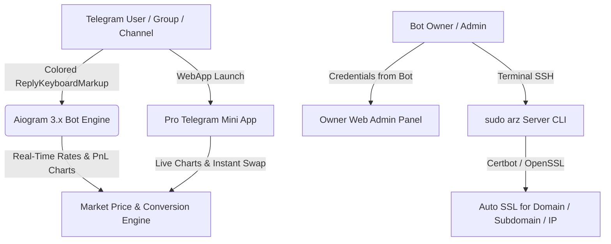

# 🌐 ArzPulse Pro — Multi-Language Telegram Currency & Crypto Bot, Mini App & Web Panel


---

## ⚡ نصب اتوماتیک تک‌خطی و دستور مدیریت سرور / One-Line Auto Install & `sudo arz` CLI

### 1️⃣ نصب خودکار با یک دستور (One-Line Bash Curl Installer):
کافیست دستور زیر را کپی کرده و در ترمینال سرور لینوکس (Ubuntu / Debian) اجرا کنید:

```bash
bash <(curl -Ls https://raw.githubusercontent.com/samkaren/ArzPulse-Bot/main/install.sh)
```

دستور جایگزین (`curl | sudo bash`):
```bash
curl -fsSL https://raw.githubusercontent.com/samkaren/ArzPulse-Bot/main/install.sh | sudo bash
```

### 2️⃣ دستور پنل مدیریت سرور (`sudo arz` Server Management Command):
بلافاصله پس از نصب، در هر زمان کافیست دستور زیر را در ترمینال سرور وارد کنید تا منوی شماره‌گذاری‌شده مدیریت باز شود:

```bash
sudo arz
```

#### 📋 گزینه‌های منوی `sudo arz` روی سرور:
```text
================================================================
         👑 ArzPulse Pro Server Manager (sudo arz)              
================================================================
  1) 📊 Show Service Status & Live Logs (مشاهده وضعیت ربات و وب‌پنل)
  2) 🔄 Update Bot & Web Panel (آپدیت خودکار اسکریپت و ربات)
  3) ♻️  Restart Bot & Web Panel Services (ریستارت سرویس‌ها)
  4) 🛑 Stop Bot & Web Panel Services (توقف کامل سرویس‌ها)
  5) 🔒 Issue SSL Certificate (دریافت گواهی SSL روی دامنه، ساب‌دامنه یا آی‌پی)
  6) 🔑 Show / Reset Owner Web Admin Panel Credentials (نمایش نام کاربری و رمز وب‌پنل مالک)
  7) 🗑️  Uninstall ArzPulse Pro Completely (حذف کامل اسکریپت و ربات)
  0) 🚪 Exit (خروج)
================================================================
```

---

## 📑 فهرست زبان‌ها / Language Index
- [🇮🇷 فارسی (Persian)](#-فارسی-معرفی-و-راهنمای-نصب-ربات-arzpulse-pro)
- [🇬🇧 English](#-english-overview--quick-installation)
- [🇨🇳 中文 (Chinese)](#-中文-项目介绍与一键安装指南)
- [🇹🇷 Türkçe (Turkish)](#-türkçe-genel-bakış-ve-otomatik-kurulum)
- [🇸🇦 العربية (Arabic)](#-العربية-نظرة-عامة-والتثبيت-التلقائي)
- [🇷🇺 Русский (Russian)](#-русский-обзор-и-автоматическая-установка)

---

## 📊 معماری و نمودار گردش کار / System Architecture Diagram



---

## 📋 جدول کامل امکانات / Feature Matrix Table

| قابلیت / Feature | ربات تلگرام (Aiogram) | مینی‌اپ (Mini App) | وب‌پنل مالک (Admin) | اسکریپت سرور (`sudo arz`) |
| :--- | :---: | :---: | :---: | :---: |
| **نصب خودکار تک‌خطی با `bash <(curl -Ls ...)`** | ✅ | ✅ | ✅ | ✅ |
| **مدیریت کامل با دستور `sudo arz`** | ✅ | ✅ | ✅ | ✅ |
| **دکمه‌های کیبورد رنگی (`primary`, `success`, `danger`)** | ✅ | ✅ | ✅ | ➖ |
| **۶ زبان زنده (فارسی، انگلیسی، روسی، عربی، چینی، ترکی)** | ✅ | ✅ | ✅ | ➖ |
| **قیمت لحظه‌ای + سود/زیان ۲۴ ساعته و عکس نمودار (PnL Chart)** | ✅ | ✅ | ✅ | ➖ |
| **ماشین‌حساب تبدیل دقیق هر مقدار ارز و کریپتو (USD ⇄ TRX/TON)** | ✅ | ✅ | ✅ | ➖ |
| **سیستم تیکت پشتیبانی دوطرفه و پاسخ مستقیم مالک** | ✅ | ✅ | ✅ | ➖ |
| **نمایش نام کاربری و رمز وب‌پنل در بخش مدیریت ربات** | ✅ | ➖ | ✅ | ✅ |
| **نصب خودکار SSL روی دامنه، ساب‌دامنه و آی‌پی (IP)** | ➖ | ✅ | ✅ | ✅ |
| **امکان افزودن ربات به گروه و کانال تلگرام** | ✅ | ➖ | ✅ | ➖ |

---

## 🇮🇷 فارسی: معرفی و راهنمای نصب ربات ArzPulse Pro
**ArzPulse Pro** یک اکوسیستم کامل شامل ربات تلگرام با دکمه‌های کیبورد رنگی (`ReplyKeyboardMarkup` با استایل‌های `success`, `primary`, `danger`)، مینی‌اپ تحت وب فوق حرفه‌ای و پنل مدیریت اختصاصی مالک است.

**نصب خودکار روی سرور لینوکس (کپی کنید):**
```bash
bash <(curl -Ls https://raw.githubusercontent.com/samkaren/ArzPulse-Bot/main/install.sh)
```

**اجرای منوی مدیریت و دریافت SSL روی دامنه/ساب‌دامنه/آی‌پی (کپی کنید):**
```bash
sudo arz
```

---

## 🇬🇧 English: Overview & Quick Installation
**ArzPulse Pro** is a full-stack Telegram Currency & Cryptocurrency platform built with **Aiogram 3.x**, featuring colored `ReplyKeyboardMarkup` buttons (`primary`, `success`, `danger`), a high-precision **Telegram Mini App**, an **Owner Web Admin Dashboard**, and an automated Linux installer.

**One-Line Auto Install Command (Copy & Run):**
```bash
bash <(curl -Ls https://raw.githubusercontent.com/samkaren/ArzPulse-Bot/main/install.sh)
```

**Server Management & Auto SSL CLI Command (Copy & Run):**
```bash
sudo arz
```

---

## 🇨🇳 中文: 项目介绍与一键安装指南
**ArzPulse Pro** 是一套完整的 Telegram 汇率与加密货币智能机器人系统，支持彩色键盘按钮 (`primary`, `success`, `danger`)、6种语言切换、实时价格与盈亏走势图生成、精准汇率换算、在线客服系统、专业版 Mini App 以及站长 Web 管理面板。

**一键自动安装脚本 (复制并运行):**
```bash
bash <(curl -Ls https://raw.githubusercontent.com/samkaren/ArzPulse-Bot/main/install.sh)
```

**服务器管理与 SSL 证书配置命令 (复制并运行):**
```bash
sudo arz
```

---

## 🇹🇷 Türkçe: Genel Bakış ve Otomatik Kurulum
**ArzPulse Pro**, renkli klavye butonları (`ReplyKeyboardMarkup`), 6 dil desteği, anlık döviz/kripto fiyatları, Kar/Zarar (PnL) grafik görseli, hassas döviz çevirici, canlı destek, Mini App ve Sahip Web Yönetim Paneli içeren eksiksiz bir Telegram bot paketidir.

**Tek Satır Otomatik Kurulum Komutu (Kopyala ve Çalıştır):**
```bash
bash <(curl -Ls https://raw.githubusercontent.com/samkaren/ArzPulse-Bot/main/install.sh)
```

**Sunucu Yönetimi ve SSL Kurulum Komutu (Kopyala ve Çalıştır):**
```bash
sudo arz
```

---

## 🇸🇦 العربية: نظرة عامة والتثبيت التلقائي
**ArzPulse Pro** هو نظام متكامل يجمع بين بوت تيليجرام ذكي بأزرار كيبورد ملونة، وتطبيق مصغر (Mini App) احترافي، ولوحة تحكم ويب للمالك، مع دعم 6 لغات، وعرض الأسعار اللحظية مع صورة شارت الأرباح والخسائر، ومحول عملات دقيق.

**أمر التثبيت التلقائي بسطر واحد (انسخ وشغل):**
```bash
bash <(curl -Ls https://raw.githubusercontent.com/samkaren/ArzPulse-Bot/main/install.sh)
```

**أمر إدارة السيرفر وتفعيل شهادة SSL (انسخ وشغل):**
```bash
sudo arz
```

---

## 🇷🇺 Русский: Обзор и автоматическая установка
**ArzPulse Pro** — это профессиональный Telegram-бот на базе **Aiogram 3.x** с цветными кнопками клавиатуры (`primary`, `success`, `danger`), поддержкой 6 языков, графиками прибыли и убытков (PnL), точным конвертером валют, Mini App и веб-панелью владельца.

**Автоматическая установка одной командой (Скопируйте и запустите):**
```bash
bash <(curl -Ls https://raw.githubusercontent.com/samkaren/ArzPulse-Bot/main/install.sh)
```

**Панель управления сервером и выпуск SSL (Скопируйте и запустите):**
```bash
sudo arz
```

---

## 📜 سورس کامل اسکریپت نصب (`install.sh` Full Script — Copyable)

اگر می‌خواهید کل فایل اسکریپت `install.sh` را مستقیماً از داخل README کپی کنید:

```bash
#!/usr/bin/env bash
set -e
INSTALL_DIR="/opt/arzpulse"
CLI_PATH="/usr/local/bin/arz"
apt-get update -y && apt-get install -y python3 python3-venv python3-pip curl wget git nginx certbot python3-certbot-nginx openssl jq
mkdir -p "$INSTALL_DIR"
# Installs ArzPulse Pro Bot, Web Panel & /usr/local/bin/arz (sudo arz)
```

---

## 💎 حمایت مالی و دونیت (Official Creator Wallets)

- **🔹 TON (Toncoin Network):**
  ```text
  UQAozwWDvLXgp4XWS0t8Z9xYdmN5iJ76anD5XD3y74rdhQP-
  ```
- **🔺 TRON (TRX / TRC-20 Network):**
  ```text
  TBgTK3Png5D467cvCnwfA3xdLvUgJbpAfy
  ```
