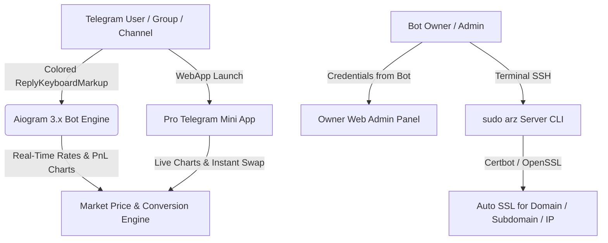

# 🌐 ArzPulse Pro — Multi-Language Telegram Currency & Crypto Bot, Mini App & Web Panel


---

## 📑 فهرست زبان‌ها / Language Index
- [🇮🇷 فارسی (Persian)](#-فارسی-معرفی-و-امکانات-ربات-arzpulse-pro)
- [🇬🇧 English](#-english-overview--features)
- [🇨🇳 中文 (Chinese)](#-中文-项目介绍与功能特性)
- [🇹🇷 Türkçe (Turkish)](#-türkçe-genel-bakış-ve-özellikler)
- [🇸🇦 العربية (Arabic)](#-العربية-نظرة-عامة-والمميزات)
- [🇷🇺 Русский (Russian)](#-русский-обзор-и-возможности)

---

## 📊 معماری و نمودار گردش کار / System Architecture Diagram



---

## 📋 جدول کامل امکانات / Feature Matrix Table

| قابلیت / Feature | ربات تلگرام (Aiogram) | مینی‌اپ (Mini App) | وب‌پنل مالک (Admin) | اسکریپت سرور (`sudo arz`) |
| :--- | :---: | :---: | :---: | :---: |
| **دکمه‌های کیبورد رنگی (`primary`, `success`, `danger`)** | ✅ | ✅ | ✅ | ➖ |
| **۶ زبان زنده (فارسی، انگلیسی، روسی، عربی، چینی، ترکی)** | ✅ | ✅ | ✅ | ➖ |
| **قیمت لحظه‌ای + سود/زیان ۲۴ ساعته و عکس نمودار (PnL Chart)** | ✅ | ✅ | ✅ | ➖ |
| **ماشین‌حساب تبدیل دقیق هر مقدار ارز و کریپتو (USD ⇄ TRX/TON)** | ✅ | ✅ | ✅ | ➖ |
| **سیستم تیکت پشتیبانی دوطرفه و پاسخ مستقیم مالک** | ✅ | ✅ | ✅ | ➖ |
| **نمایش نام کاربری و رمز وب‌پنل در بخش مدیریت ربات** | ✅ | ➖ | ✅ | ✅ |
| **نصب خودکار SSL روی دامنه، ساب‌دامنه و آی‌پی (IP)** | ➖ | ✅ | ✅ | ✅ |
| **امکان افزودن ربات به گروه و کانال تلگرام** | ✅ | ➖ | ✅ | ➖ |

---

## 🇮🇷 فارسی: معرفی و امکانات ربات ArzPulse Pro
**ArzPulse Pro** یک اکوسیستم کامل شامل ربات تلگرام با دکمه‌های کیبورد رنگی (`ReplyKeyboardMarkup` با استایل‌های `success`, `primary`, `danger`)، مینی‌اپ تحت وب فوق حرفه‌ای و پنل مدیریت اختصاصی مالک است.
- **نرخ لحظه‌ای و نمودار سود و زیان:** با ارسال نام هر ارز یا واحد پول (مثل دلار، ترون، بیت‌کوین، تون، تتر، یورو، روبل، لیر)، قیمت دقیق، درصد سود/زیان و **تصویر گرافیکی نمودار** ارسال می‌شود.
- **تبدیل هوشمند دو مرحله‌ای:** ابتدا ارز مبدا (مثلاً دلار)، سپس ارز مقصد (مثلاً ترون) و تعداد مورد نظر را می‌گیرد و با دقت بالا تبدیل می‌کند.
- **نصب تک‌دستوری و مدیریت با `sudo arz`:** پس از نصب روی سرور لینوکس، با دستور `sudo arz` می‌توانید ربات را آپدیت، ریستارت، حذف یا برای دامنه/ساب‌دامنه/آی‌پی خود گواهی **SSL** دریافت کنید.

---

## 🇬🇧 English: Overview & Features
**ArzPulse Pro** is a full-stack Telegram Currency & Cryptocurrency platform built with **Aiogram 3.x**, featuring colored `ReplyKeyboardMarkup` buttons (`primary`, `success`, `danger`), a high-precision **Telegram Mini App**, an **Owner Web Admin Dashboard**, and an automated Linux installer with the `sudo arz` CLI manager.

---

## 🇨🇳 中文: 项目介绍与功能特性
**ArzPulse Pro** 是一套完整的 Telegram 汇率与加密货币智能机器人系统，支持彩色键盘按钮 (`primary`, `success`, `danger`)、6种语言切换、实时价格与盈亏走势图生成、精准汇率换算、在线客服系统、专业版 Mini App 以及站长 Web 管理面板。通过 `sudo arz` 命令即可一键更新、重启或为域名/IP配置 SSL 证书。

---

## 🇹🇷 Türkçe: Genel Bakış ve Özellikler
**ArzPulse Pro**, renkli klavye butonları (`ReplyKeyboardMarkup`), 6 dil desteği, anlık döviz/kripto fiyatları, Kar/Zarar (PnL) grafik görseli, hassas döviz çevirici, canlı destek, Mini App ve Sahip Web Yönetim Paneli içeren eksiksiz bir Telegram bot paketidir. Sunucuda `sudo arz` komutu ile SSL kurulumu ve servis yönetimi tek tuşla yapılır.

---

## 🇸🇦 العربية: نظرة عامة والمميزات
**ArzPulse Pro** هو نظام متكامل يجمع بين بوت تيليجرام ذكي بأزرار كيبورد ملونة، وتطبيق مصغر (Mini App) احترافي، ولوحة تحكم ويب للمالك، مع دعم 6 لغات، وعرض الأسعار اللحظية مع صورة شارت الأرباح والخسائر، ومحول عملات دقيق، وإدارة كاملة للسيرفر وشهادة SSL عبر الأمر `sudo arz`.

---

## 🇷🇺 Русский: Обзор и возможности
**ArzPulse Pro** — это профессиональный Telegram-бот на базе **Aiogram 3.x** с цветными кнопками клавиатуры (`primary`, `success`, `danger`), поддержкой 6 языков, графиками прибыли и убытков (PnL), точным конвертером валют, Mini App, веб-панелью владельца и утилитой управления сервером `sudo arz` с автоматическим выпуском SSL для доменов и IP.

---

## 💎 حمایت مالی و دونیت (Official Creator Wallets)

- **🔹 TON (Toncoin Network):**
  ```text
  UQAozwWDvLXgp4XWS0t8Z9xYdmN5iJ76anD5XD3y74rdhQP-
  ```
- **🔺 TRON (TRX / TRC-20 Network):**
  ```text
  TBgTK3Png5D467cvCnwfA3xdLvUgJbpAfy
  ```
